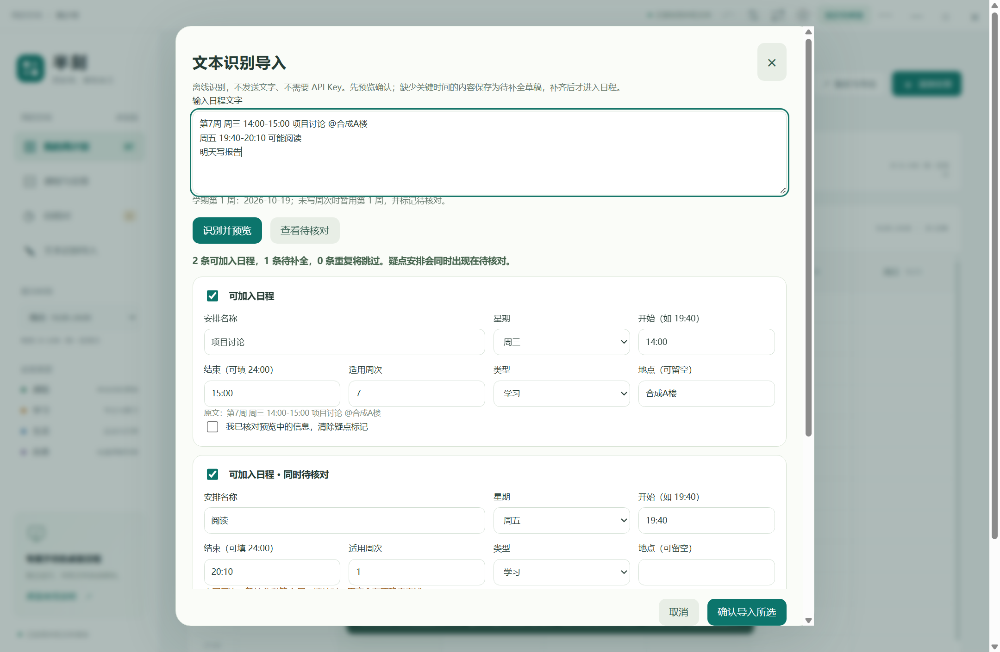
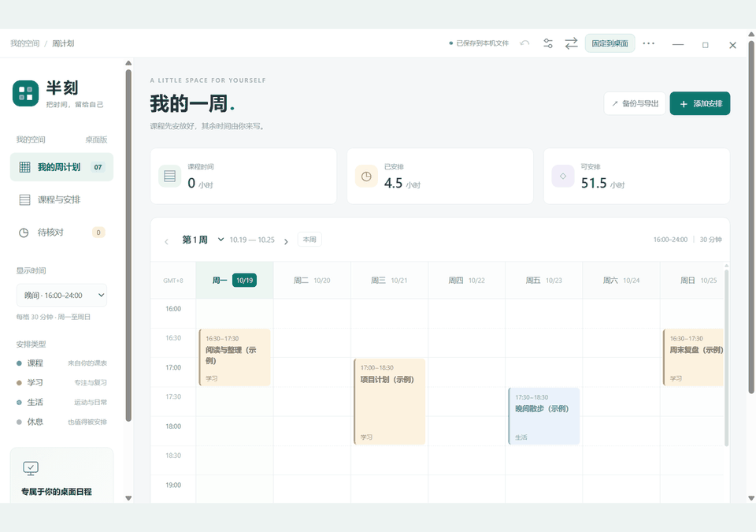
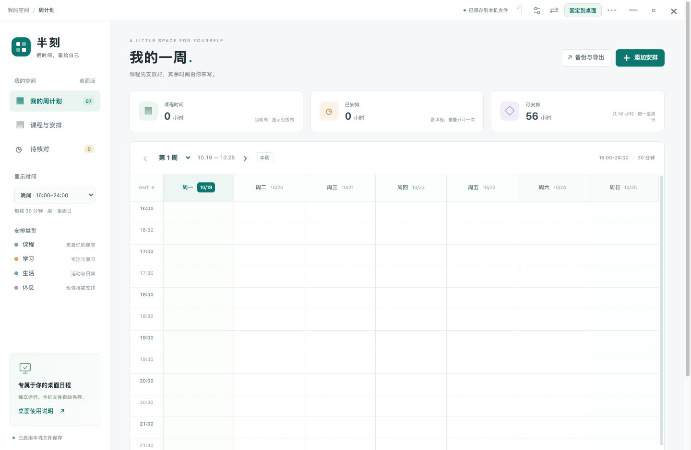

# 半刻 Banke · 把日子安排得刚刚好

半刻是一款用来安排课程和日常事务的周计划应用。添加安排时，可以把起止时间精确到分钟，并选择在哪些教学周重复。平时可以在日历或列表中查看，需要留档时也能导出或打印。

在 Windows 上，半刻既能像普通软件一样打开，也能把日程固定在桌面右半屏，方便随时查看。手机端可以离线记录和修改安排，之后再通过同一 Wi-Fi 与电脑同步。

通用版第一次打开时是空白日程，需要你自己添加内容。它与私人版分别保存数据和配对信息，不会自动读取或导入私人版的课表。目前 Windows 和 Android 的正式版本是 1.3.4，源码按 MIT 许可证开放；macOS 和 iPhone 另有测试版。

## 下载与安装

仓库中的 Windows 1.3.5 源码已加入莲花呼吸字幕：舒展时显示“念念相续”，收拢时显示“无喜无惧”。当前可直接下载的稳定安装包仍为下面的 1.3.4。

你可以在 [1.3.4 正式下载页](https://github.com/Hash012/Banke/releases/tag/v1.3.4)找到安装包、源码和校验文件。这一版同时更新了 Windows 和 Android，加入了文本导入功能，具体变化和验证情况可以查看[发布记录](docs/RELEASE.md)。

如果使用 Windows 10 或 Windows 11 的 x64 电脑，下载 [Windows 安装包](https://github.com/Hash012/Banke/releases/download/v1.3.4/Banke-Community-Setup-1.3.4-x64.exe)后，按提示选择安装位置即可。安装包已经包含运行所需的组件，不需要另外安装浏览器、Node、Python 或 Go。升级时请先正常退出旧版，再运行新版安装包，已有通用版日程和配对会保留。

如果希望解压后直接使用，可以下载 [Windows 便携包](https://github.com/Hash012/Banke/releases/download/v1.3.4/Banke-Community-1.3.4-Windows-x64.zip)。请完整解压，再打开其中的 `BankeCommunity.exe`。Windows 安装包和便携包目前都没有发布者代码签名。

手机版请下载 [Android 安装包](https://github.com/Hash012/Banke/releases/download/v1.3.4/Banke-Community-Android-1.3.4.apk)。它支持 Android 8 及以上系统，也适用于仍能安装 APK 的 HarmonyOS；它不是 HarmonyOS NEXT 的原生 HAP 应用。新版沿用通用版原有签名，升级时请保留应用数据。

如果想阅读或自行构建程序，可以下载 [1.3.4 源码快照](https://github.com/Hash012/Banke/releases/download/v1.3.4/Banke-Source.zip)，也可以直接克隆本仓库。下载文件的 SHA-256 摘要列在[校验清单](https://github.com/Hash012/Banke/releases/download/v1.3.4/SHA256SUMS.txt)中。仓库根目录的 `Banke-Android.apk` 和 `Banke-Source.zip` 分别对应这一版的手机安装包和源码快照。Windows 完整包体积较大，放在 Releases 附件中分发。

仓库中还保留着旧版发行记录。其中，v1.1.0 是使用 Go 实现的早期预览版，界面和同步协议都与当前版本不同，请勿与新版混装配对。

## 从文字导入日程

如果手头已经有一段课程通知或活动安排，可以在电脑左栏点击“文本识别导入”，手机上则点击顶部的同名按钮。粘贴文字后，点击“识别并预览”，检查每条安排的名称、星期、起止时间、周次、类型和地点，修改妥当后再确认导入。取消预览不会保存到日程表。

例如，你可以输入“第1-16周（单周）周一、周三 09:00-10:00 数学 @A楼”，也可以写“明天下午三点到五点，项目讨论”。程序能识别常见的日期、中文时间、多个星期和单双周，但复杂的自然语言仍可能识别不全，所以导入前请检查预览。

“今天”“明天”“下周”等说法按北京时间计算。如果没有写周次，程序会暂用当前查看的教学周，并把这条安排标为待核对。时间完整但还有疑点的内容会进入日程表，同时出现在“待核对”中；缺少名称、日期、起止时间或有效周次的内容则先保存为草稿，补全后才会排进日程。

对于名称、星期、时间和地点都相同的安排，程序会跳过已经存在的周次，只补上尚未添加的部分。待补全草稿只保存在当前设备，成为日程后才能通过原有配对同步到另一端。

这项功能使用离线规则识别，不会把你输入的文字发送给人工智能服务，也不需要 DeepSeek API Key。目前没有提供 DeepSeek 配置入口。

下图是在 Windows 原生窗口中，用合成安排演示的导入预览。

## 莲花桌宠与日程提醒

“念念相续”是一朵可以放在桌面上的莲花。它从 Windows 1.3.3 起加入半刻，默认关闭。点击右上角的“❀”，或在桌面菜单中打开“莲花桌宠与提醒”，勾选开启并保存，就可以使用。

你可以分别开启开始提醒和结束提醒，也可以分别设置提前多久提醒。提前量支持 0 到 1440 分钟，默认在开始前 5 分钟、结束前 1 分钟提醒；填 0 就表示准时提醒。

莲花字幕会随呼吸轻柔交替：舒展时是“念念相续”，收拢时是“无喜无惧”，每 7 秒完成一轮。提醒时会跟随莲花切换到 3 秒一轮；如果系统开启“减少动态效果”，则静态同时显示两句话。

莲花可以拖到合适的位置，并记住上次的位置。透明区域不会挡住鼠标操作，是否悬浮在其他窗口上方也可以单独选择。提醒会根据实际日期和适用周次触发，跳过已完成的安排；同时有多条提醒时，可以逐条确认。退出后重新打开，也不会重复弹出已经确认过的提醒。

这些设置只保存在当前电脑。半刻需要保持运行才能提醒，退出软件或关机后不会提醒。原有的桌面右半屏日程挂件仍然可以照常使用。

下图来自 Windows 1.3.3 实际打包程序，使用的是合成日程。具体测试方式和仍未覆盖的情况可以查看[验收记录](docs/TESTING.md)。

## 让手机和电脑保持同步

先在电脑和手机上安装通用版半刻，并让两台设备连接到能够互相访问的可信 Wi-Fi。在电脑中打开“手机自动同步”，开启局域网同步，再点击“允许新手机配对 · 2 分钟”。

接着，在手机上填写电脑显示的完整地址并连接。地址里需要包含端口，不要直接沿用以前保存的旧地址。两端出现八位数字后，请确认数字完全一致，再在电脑上允许连接；不要把配对数字或密钥发给别人。

配对完成后，修改会先保存在本机，再自动同步到另一端。断网时仍可以编辑，重新连上后会继续同步。使用时请尽量让手机版保持在前台，因为后台运行可能受到手机省电设置的限制。

电脑会记住上次成功使用的端口。如果端口被占用或被系统保留，半刻会选择其他可用端口，并在界面中显示实际地址，不会结束占用端口的程序。电脑地址发生变化时，在手机上更新地址即可保留原配对；目前还不能自动发现地址变化。

手机和电脑沿用同一套加密同步协议。配对时会建立双方专用的密钥，随后交换的日程会加密，并检查消息顺序，防止过期的修改被重新提交。请在可信的局域网内使用，无需为此关闭防火墙；目前没有云账号或公网同步服务，锁屏后也不能保证实时同步。

如果使用 Mac 或 iPhone，请先阅读下方测试版说明，并在首次连接时允许系统要求的本地网络访问权限。

## 数据与备份

通用版和私人版可以并存，各自保留安装、日程和配对信息。Windows 通用版把数据保存在 `%APPDATA%\BankeCommunity`，程序名称是 `BankeCommunity.exe`；macOS 通用版的数据位于 `~/Library/Application Support/BankeCommunity`。手机端则把日程和配对保存在各自应用的独立存储中，iPhone 源码版还会将这些文件排除在系统云备份之外。

升级或卸载 Windows 通用版不会主动清理日程。排查问题时，请不要删除 AppData、手机应用数据或配对文件。同步也不能代替备份，重要修改前最好单独导出一份 JSON 文件。

Windows 导入备份时，会先显示预览，并为当前日程保存一份独立备份。只有确认文件有效、且预览之后没有其他新修改时，才会提交替换；取消操作或遇到错误都不会覆盖原有日程。早期 Go 预览版的数据也需要先由你导出 JSON，再在新版中选择导入，不会自动迁移。

## 看看实际使用的样子

下面的动图来自 Windows 上实际安装的通用版 1.3.2，展示了从周计划切换到课程列表、修改安排，再保存返回的过程。演示使用合成日程，首次安装的半刻仍从空白开始。视频主要展示日程编辑，后来加入的文本导入和莲花提醒可以查看上方的截图。

点击动图可以观看[完整视频](https://github.com/Hash012/Banke/releases/download/v1.3.2/Banke-Community-Demo-1.3.2.mp4)，时长为 16.8 秒，没有音轨。你也可以查看同次录制的[窗口截图](docs/media/community-desktop.png)，或阅读[演示来源说明](docs/media/README.md)。

## macOS 和 iPhone 测试版

Apple 平台目前提供的是[独立的 1.3.2 预览版](https://github.com/Hash012/Banke/releases/tag/v1.3.2-apple-preview.1)，它的附件没有随 Windows 和 Android 的 1.3.4 一起更新。开发进展和测试范围可以查看 [Apple 验收说明](docs/APPLE.md)。

使用 Apple Silicon，也就是 M 系列芯片的 Mac，可以下载 [Apple Silicon 的 DMG 安装镜像](https://github.com/Hash012/Banke/releases/download/v1.3.2-apple-preview.1/Banke-Community-1.3.2-macOS-arm64-preview.dmg)或 [ZIP 压缩包](https://github.com/Hash012/Banke/releases/download/v1.3.2-apple-preview.1/Banke-Community-1.3.2-macOS-arm64-preview.zip)。使用 Intel 芯片的 Mac，则请选择 [Intel 的 DMG 安装镜像](https://github.com/Hash012/Banke/releases/download/v1.3.2-apple-preview.1/Banke-Community-1.3.2-macOS-x64-preview.dmg)或 [ZIP 压缩包](https://github.com/Hash012/Banke/releases/download/v1.3.2-apple-preview.1/Banke-Community-1.3.2-macOS-x64-preview.zip)。两种架构都已经在对应的原生构建机上运行验证，但仍作为测试版提供。

Mac 版本使用 ad-hoc 完整性签名，没有经过 Developer ID 签名或 Apple 公证，首次打开时可能被系统拦截。确认下载来源和文件摘要后，可以参照 [Apple 官方说明](https://support.apple.com/zh-cn/102445)，对这一个应用选择“仍要打开”。安装时将应用拖入“应用程序”即可，请保留已有的日程目录。

Mac 的构建目标是 macOS 12 及以上，目前的原生运行验证使用 macOS 15。个人设备上的首次打开、Mission Control、触控板手势和登录启动等情况仍待验证。下图是原生构建机运行实际打包应用时取得的内部窗口截图，初始日程为空。

iPhone 暂时没有可直接安装的 IPA。你可以下载[完整 Xcode 源码](https://github.com/Hash012/Banke/releases/download/v1.3.2-apple-preview.1/Banke-Community-Apple-Source-1.3.2-preview.1.zip)，在自己的 Mac 上用 Xcode 选择开发团队并签名安装；具体步骤见 [iPhone 构建说明](mobile/ios/README.md)。

## 自行构建与验证

构建 Windows 版本需要 Node 22.12 及以上版本，并且需要联网下载依赖。在仓库目录先执行 `npm ci` 安装锁文件中指定的依赖，再执行 `npm test` 运行测试。开发时可以用 `npm start` 打开程序，需要生成完整安装包和便携包时则执行 `npm run dist:win`。

首次安装依赖时，脚本会下载官方 Electron，并核对 npm 包中记录的 SHA-256 摘要。普通用户直接使用已打包的 Windows 程序即可，不需要安装开发工具。Android 的 Java、官方 SDK 和签名构建方式见[构建说明](docs/BUILD.md)。

测试记录会分别说明哪些结果来自单元测试，哪些来自实际运行的桌面程序、安装后的程序或用户操作的手机。单元测试和解包检查不能代替实机验收；如果想了解具体结果，可以阅读[验收记录](docs/TESTING.md)、[开发记录](WORKLOG.md)和[安全说明](SECURITY.md)。
