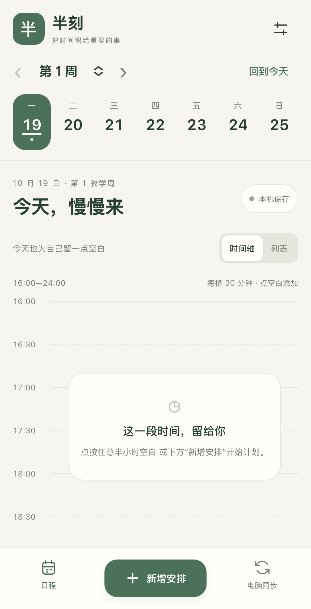

# Apple 测试版构建与验收

日期：2026-10-19。用户确认没有 Mac/Apple 开发者签名条件，选择 Mac 测试版和可自行签名的 iOS 源码。公开代码位于 mobile/ios 和原有 desktop；完整源码 ZIP 保留同一仓库层级，包括共用 mobile/web、Xcode 工程和构建/测试脚本。

## macOS

分别提供 Apple Silicon arm64、Intel x64 的完整 DMG 与 ZIP，内含 Electron 运行时。保持同一周计划 UI、默认空白、备份和协议 1 同步代码；增加自身 NSView 对应 NSWindow 的原生桌面层，保持独立编辑窗口，桌面层低于普通应用窗口。没有把挂件改成始终置顶。

| 已执行 | 结果 |
| --- | --- |
| 两种原生架构 npm ci、回归、打包 | PASS；GitHub 原生 macOS 15 构建机 |
| Mac 原生签名完整性 | PASS；ad-hoc 签名，codesign --verify --deep --strict；不是 Developer ID 或 Apple 公证 |
| 实际完整 .app 运行、首次空白 | PASS；真实已打包应用进程，不是仅解压或浏览器复刻 |
| 实际页面编辑保存 | PASS；真实应用 UI 与磁盘，合成安排 |
| 固定/返回五轮 | PASS；两架构均通过，CoreGraphics 读取到本进程可见的负桌面窗口层级，返回独立普通窗口 |
| 正常退出/重开保留日程 | PASS；日程字节和事件保留 |
| 下载构建产物审阅 | PASS；两种 Mach-O 架构与应用标识正确；每种 28 个打包应用源文件与仓库逐字节一致 |

原生运行与签名 run：[39264627038](https://github.com/Hash012/Banke/actions/runs/39264627038)，对应源提交 bbe6dd7019a889b3a671953a4224e67625b0e561。后续增加的是 iOS 与发布工具；上传前仍须复核 Mac 打包源码与最终标签一致。

Mac 操作通过真实打包应用的本地 CDP 驱动，图片为应用内部渲染截图；同时独立查询原生窗口层级。这些证据不等同用户物理 Mac 上的最终桌面合成、鼠标/触控板、Mission Control 或 Gatekeeper 验收。

下载后将 DMG 中 App 拖入“应用程序”，或完整解压 ZIP。只对确认可信且摘要一致的 App，按 [Apple 官方流程](https://support.apple.com/zh-cn/102445) 处理首次打开限制；不要求关闭 Gatekeeper 或删除隔离属性。本轮没有签名/公证开发者条件。

在自己的 Mac 上构建：

```sh
npm ci
npm test
npm run dist:mac -- --arm64
# Intel Mac：npm run dist:mac -- --x64
```

构建目标 macOS 12+，只验证了 macOS 15 构建机。未测：真实个人 Mac 安装/首次安全提醒、物理桌面最终绘制与 Mission Control、触控板手势、多屏/动态 DPI、登录启动、睡眠/长期运行、原生导入/打印对话框、Mac 与真实手机同步。上述项目不借用 Windows 验收作通过。

## iPhone 源码

与 Android 社区版逐字节共用 mobile/web 的手机 UI、空白 seed、协议 1 加密与合并代码；Swift/UIKit/WKWebView 仅提供原子本地保存和受限原生 LAN 请求。先离线编辑；电脑配对是额外能力，不是保存条件。只允许打包主页面桥接、私有 IPv4 和三个同步端点，不开放电脑浏览器 Origin/CORS，不跟随 HTTP 重定向。

iOS 15+ 构建目标，org.banke.community.ios 独立身份。原生 run [39271296063](https://github.com/Hash012/Banke/actions/runs/39271296063)（源提交 1b5e123）已通过：未签名设备目标和模拟器目标编译、原生存储错误不覆盖及私网 URL 边界、实际 WKWebView 空白启动、离线 UI 保存、新文档重载后持久化、WebCrypto、原生 HTTP 配对和生产协议服务加密双向往返。服务确认一台合成设备收到手机安排，电脑改名后手机收到。不是物理 iPhone 验收。



图片由实际模拟器 App 的 WKWebView 内部快照取得，拍摄于配对前，无地址、配对数字或私人日程。

```sh
# 原生 macOS / Xcode，从仓库根目录运行：
python3 scripts/build_ios.py --simulator
python3 scripts/build_ios.py --device --simulator --test
```

--device 是未签名设备编译校验，不生成伪称可安装的 IPA。--test 创建自己命名的独立模拟器并在结束后关闭它，不清理已有模拟器或手机数据。签名安装步骤见 [iOS README](../mobile/ios/README.md)。实际个人 iPhone、最低 iOS 版本、本地网络权限弹窗、强制结束/后台/锁屏、TestFlight/App Store 未测。

## Windows 回归与数据

共享入口变更已在原 Windows 电脑使用隔离副本回归：五轮实际 Windows UI Automation 固定/返回、原生系统选择器导入预览/取消/自动备份/错误和并发保护均通过；无 1400、preload/renderer 退出。此前六轮指针成功和后续遮挡/前台焦点中止单独记录，没有写成十轮全通过。旧 Windows/Android v1.3.2 稳定发行和私人数据、配对未更动。

原始运行数据与日志只在 .local；仅审阅过的合成 App 截图可公开。Apple 源码白名单排除私钥、描述文件、Xcode 个人状态、运行存档和 SDK，iOS 不发布签名身份。源码和发行附件最终摘要见 Apple-SHA256SUMS.txt。

WebKit 异步测试处理参考 [Apple callAsyncJavaScript 文档](https://developer.apple.com/documentation/webkit/wkwebview/callasyncjavascript(_:arguments:in:in:completionhandler:))；本地网络配置参考 [Apple NSAllowsLocalNetworking](https://developer.apple.com/documentation/bundleresources/information-property-list/nsapptransportsecurity/nsallowslocalnetworking)。测试保留异步操作并确认页面重载完成，不更改协议或允许任意公网 HTTP。


## 公开发布结果

已发布 [v1.3.2-apple-preview.1](https://github.com/Hash012/Banke/releases/tag/v1.3.2-apple-preview.1)，Release ID 417416943，标记为预发行；源标签提交 1d0c974。现有 Latest 稳定版仍为 v1.3.2，Windows/Android 既有附件未替换。

手动上传 run [39272650415](https://github.com/Hash012/Banke/actions/runs/39272650415) 成功。草稿阶段再次比较四个 Mac 成品摘要、原生运行证明，以及源码 ZIP 中 135 个文件与标签源码逐字节一致；随后才公开发行。七个附件均不带凭据完整重新下载，文件长度、服务器 digest 与 Apple-SHA256SUMS.txt 全部匹配。公开 README 渲染的 Mac 图片、既有真实演示与 Apple 下载入口已检查，图片/源码与本机审阅版本相同。

本地成品在 dist/apple-preview；完整私有运行证据与下载核验仅留 .local，未发布存档或签名身份。发布后文档提交不改写源标签或已验证附件。
